  

&nbsp;
&nbsp;
&nbsp;

 

<b>How RouteMem decides</b>

 

Every request checks a Redis exact-match cache, then a Qdrant semantic cache. On a miss, a Lagrangian router scores each backend on cost, expected quality, latency SLA and privacy, so prompts with personal data never leave local models. The router itself is a 3B model fine-tuned with Unsloth QLoRA and GRPO for reliable structured output. Evaluated on 100 queries from GSM8K, HumanEval, LMSYS, MeetingBank and MMLU-Pro.

 

<b>Why NailStore is built this way</b>

 

Every tenant table carries an artist ID, and Postgres row-level security runs under a non-owner role, so a data leak needs two independent bugs. Slow work never blocks a request: a transactional outbox feeds BullMQ workers, and every create takes an idempotency key. An OpenAPI spec generates the typed client across a Turborepo monorepo. Fifteen ADRs and a capacity model (500 to 50,000 artists) are in the repo. Stripe Connect payments and a photo-based nail sizing service are next.

 

  

  

  

  

Open to internships and 2027 graduate roles in AI / LLM systems and backend · <a href="mailto:shreeshailchavan309@gmail.com">shreeshailchavan309@gmail.com</a>

